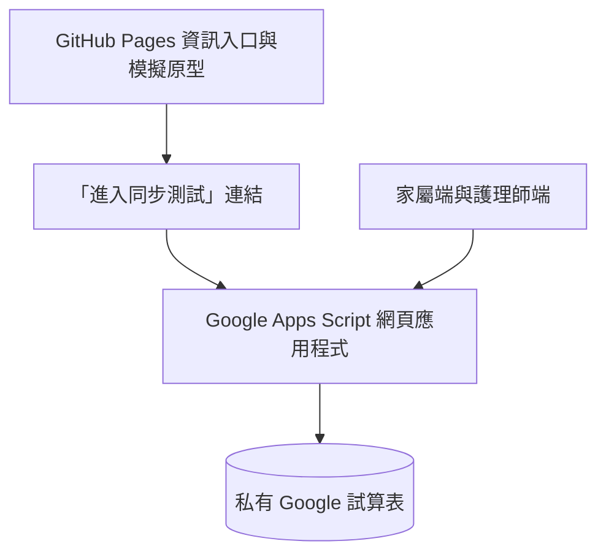

# 復健之路｜有我們與您同行

這是復健單位的**家屬／護理師共用照護 Checklist 測試版**，採「**一位病人，共用一份 Checklist**」的概念。

公開體驗：[復健之路｜有我們與您同行](https://linexepa.github.io/rehab-journey/)。

**2026-11-23 第二版：**GitHub Pages 首頁已改成「照護旅程」互動體驗，包括固定臨床教師形象的歐式插畫、虛構床位示範登入、前三站建議、八個逐站衛教、病房地點點選示意、感染預防情境問答、家屬提問和護理師本機預覽。

**重要：**新版家屬入口僅能使用公開示範個案 DEMO-001、測試代碼 DEMO2026。此代碼公開可見，只是流程體驗，**不是正式身分驗證**，不得用於真實病人。

> **資料安全：此版本僅允許虛構的 `DEMO-001`，請勿輸入任何病人姓名、病歷號、床號、病況或照護相關個資。** 發佈給真實家屬前須通過院方資訊安全、身分認證、授權、紀錄保存及個資保護審查。靜態 GitHub Pages 並不是受保護的病歷系統。

## 現有功能

- 家屬端：入院初期 8 項主題、進度顯示、已了解／需要協助／稍後再看、提問。
- 互動版：同一頁聚焦一個主題，使用圖像、情境題與簡短提醒；真正的 360° 實景尚待單位拍攝與審核。
- 本機紀錄：Checklist 與提問不跨裝置同步、不寄 Gmail，也不會寫入 Google 試算表。
- 影片：觀看者稱呼、與病人關係、影片開啟／自述已看完分開記錄。尚未設定影片網址時只做登記，不會誤記為「已觀看」。
- 護理師端：共同進度、待協助統計、家屬問題、影片紀錄、口頭說明及技能確認狀態。
- 待新增：360° 環境實景、護理站分機、經核准的 YouTube 影片、其他住院階段。

## 架構與資料流

GitHub Pages 是**靜態網站**，不能直接把填寫資料寫入私有 Google Sheet；此專案使用 Google Apps Script 的 HTML Service (`google.script.run`) 作為表單、權限邏輯與試算表之間的伺服器層。**GitHub 頁面上的 Checklist 是瀏覽器本機示範模式；只有連到 Apps Script 網頁應用程式時，操作才會寫入試算表。**

## A. 本機及 GitHub Pages 示範

根目錄的 `index.html`、`styles.css`、`journey-v2.js` 和 `assets/clinical-teacher-hero-v2.webp` 是第二版 GitHub Pages 介面；`app.js` 為舊版原型保留檔案。靜態示範在瀏覽器 localStorage 保存 `DEMO-001` 的進度，只在同一台／同一個瀏覽器可見；照顧者示範稱呼保存在 sessionStorage。本機操作不會寄信或寫入 Sheet。

## B. Google Apps Script 同步測試

1. 在擁有私有測試試算表編輯權限的 Google 帳號，建立一個**獨立的 Apps Script 專案**。
2. 複製 `gas/Code.gs` 至 Apps Script 的 `Code.gs`。將 `gas/Index.html`、`gas/Styles.html`、`gas/App.html` 分別建立為 Apps Script 的三個 HTML 檔案，檔名為 `Index`、`Styles`、`App`。
3. 在 **專案設定 → 指令碼屬性** 建立：
   - `SPREADSHEET_ID`：私有測試 Google Sheet 的文件 ID（不要放在公開 GitHub 的設定檔）。
   - `NURSE_TEST_KEY`：自己設定至少 8 字元的護理師**測試**通行碼（不要提交至 GitHub）。
4. 在 Apps Script 編輯器選擇 `testConnection` 執行一次，依照 Google 授權流程允許讀取此測試試算表；回傳內容應顯示 8 個衛教主題。
5. 在「部署 → 新部署 → 網頁應用程式」選擇**以自己身分執行**，測試期先限定**只有自己**可以存取。取得 `/exec` 網址後，用本人 Google 帳號開啟，勾選某項「需要協助」，再檢查 Sheet 的 `Checklist紀錄` 是否新增或更新 `DEMO-001`。
6. 確認寫入後，再規劃從第二版 GitHub 頁面進入受控 Apps Script `/exec`。目前第二版首頁尚未連接寫入入口；切勿將私有試算表授權資訊放進 GitHub。

**注意：**此設計不會讓 GitHub 頁面上的本機勾選同步到 Sheet。跨裝置共用狀態應由家屬打開 Apps Script 入口進行操作。任何公開開放權限的部署都必須先補齊正式身分驗證與院方資安審查；切勿將「測試通行碼」當作正式護理師帳號機制。

若日後有 YouTube 影片或 360° 導覽 URL，將它們填入測試試算表 `衛教內容管理` 對應的 `ADM-07`／`ADM-01`「影片或導覽網址」欄位，Apps Script 模式會讀取；GitHub 純模擬模式則更新 `app.js` 中的 `LINKS`。

## C. 關於版本與同步

目前 `gas/` 是**第一版 Apps Script 測試介面**，尚未授權與正式部署；GitHub Pages 的第二版介面與它**刻意分離**。不要直接執行舊的 `build-gas.mjs` 後覆蓋 GAS 檔案，除非已先完成登入權限與資料流程的重新設計。

正式版須依院方資安規範處理：不可預測的每次住院存取憑證、病房與個案對應、轉床／出院撤權、護理師獨立驗證、家屬提問保護，以及僅寄送去識別化通知。App Script `MailApp` 可以作為通知方法，但目前未實作。

## 下一階段需要討論

- 360° 拍攝範圍與畫面個資遮蔽（不納入其他病人、員工識別資訊）。
- 護理站分機、正式衛教 YouTube URL 與院內感染管制公告的最終用語。
- 家屬個案授權方式、轉床／出院撤權、護理師驗證方式及資料保存期限。
- 照護技能確認之具體細目、哪些操作需要護理師現場示範。

## 原始碼與授權

原型不包含病人資料、醫院名稱、API 金鑰或密碼。使用 Google Apps Script、Google Sheets 與自託管 GitHub Pages；若超出各服務免費額度，仍應評估配額及院方政策。
